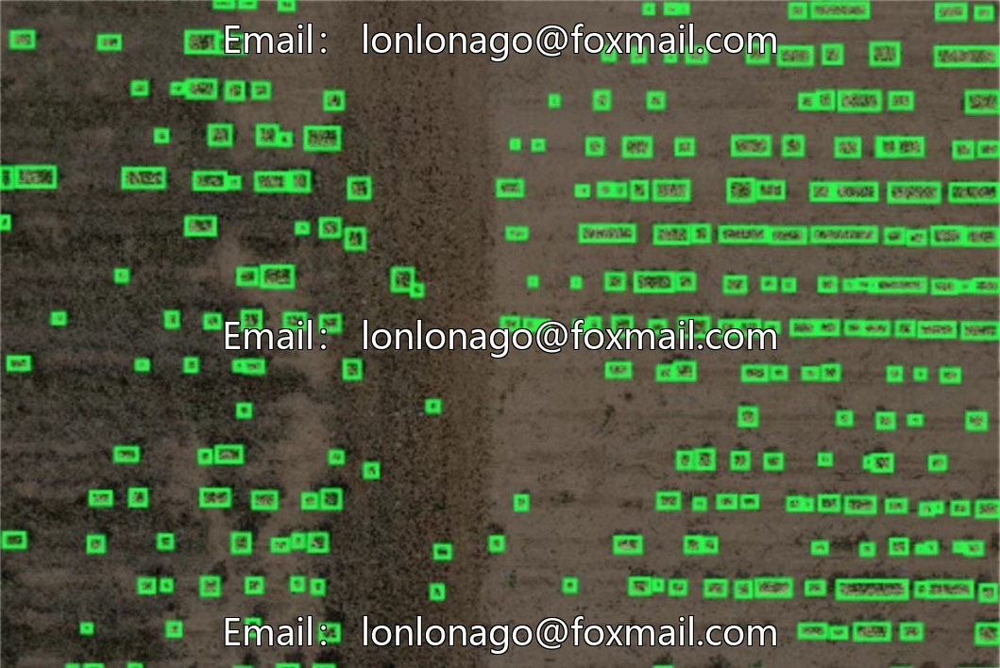
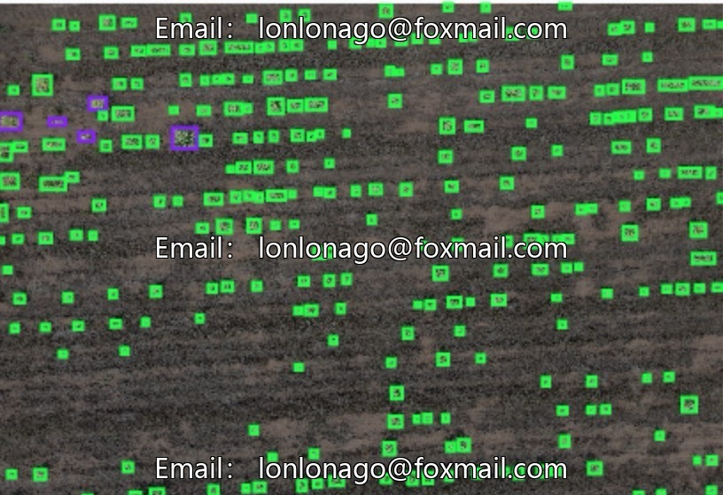
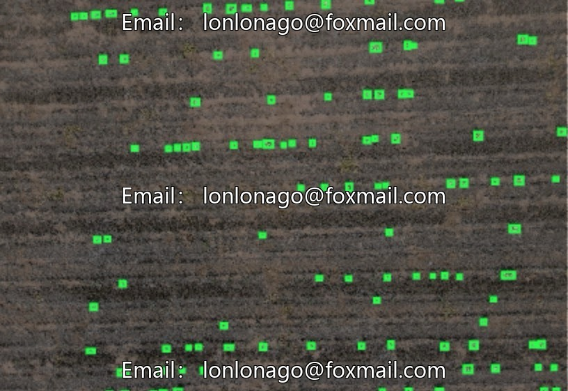
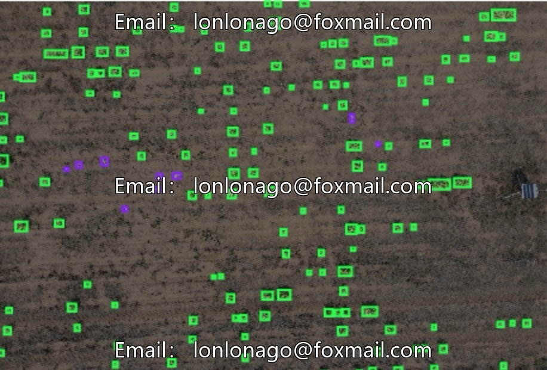
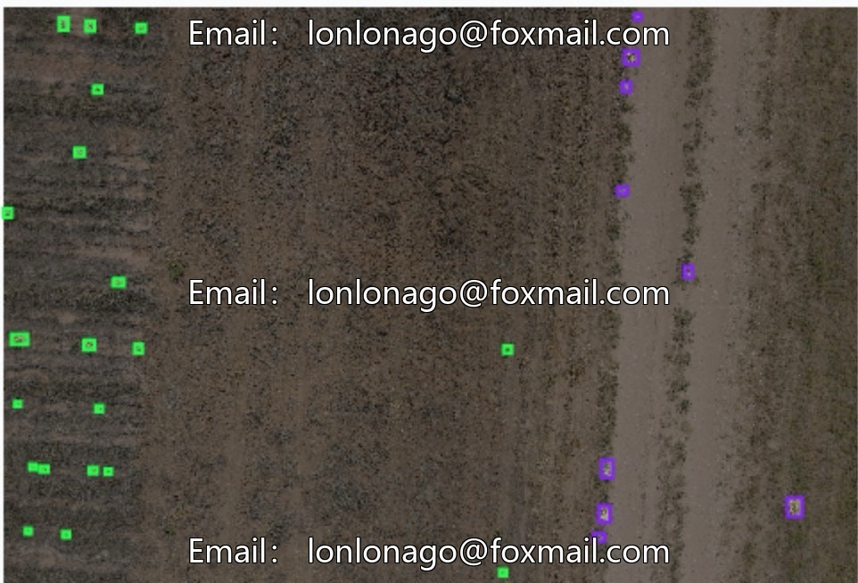

# Drone tobacco seedling inspection dataset

## Body

Drone Tobacco Seedling Inspection Data Set
10545th Edition of the Drone Tobacco Seedling Inspection Data Set
A specialized image dataset for intelligent agriculture and target detection tasks, suitable for tobacco plant seedling detection, intelligent inspection in farmlands, and deep learning model training and algorithm validation.
Basic Information
Target Class: 1 class (Tobacco Plant)
Image Count: 4600
Annotation Format: YOLO format
Application Scenarios: Farmland, outdoor complex planting environments
Dataset Explanation
This dataset is specifically constructed for the detection of tobacco plant seedlings. The data has been uniformly organized and standardized for annotation, allowing direct use for training target detection models, performance evaluation, and algorithm comparison.

Covering the differences of light, terrain and planting density in real farmland, close to the actual inspection scene, with high practical value.
Application value
Model Training: Supports training of mainstream target detection models such as YOLO and RTDETR, along with parameter tuning.
Algorithm verification: Testing the precision, speed, and robustness of the seedling emergence rate recognition algorithm
Scene Adaptation: Suitable for drone aerial inspection of farmland, intelligent agricultural monitoring, and tobacco planting management, among other practical business operations.
Research Support: Provide standardized annotation data for the research on visual recognition in smart agriculture.
Usage scenario
Drone field inspection, tobacco seedling rate statistics, plant density monitoring, development of intelligent agricultural identification systems, research on deep learning algorithms.

# Intelligent Agriculture Tobacco Seedling Rate # Computer Vision # Datasets # Object Detection # Deep Learning # Yolo Dataset # Yolo # Neural Network for Computer Vision # Python Data Processing

## Images

## Payment

Here is a pay link on Stripe ( https://buy.stripe.com/3cs8yP7sY87d0vu9AB ). Please contact me lonlonago@foxmail.com after funding $89, and I will send you a complete data files , thank you!

